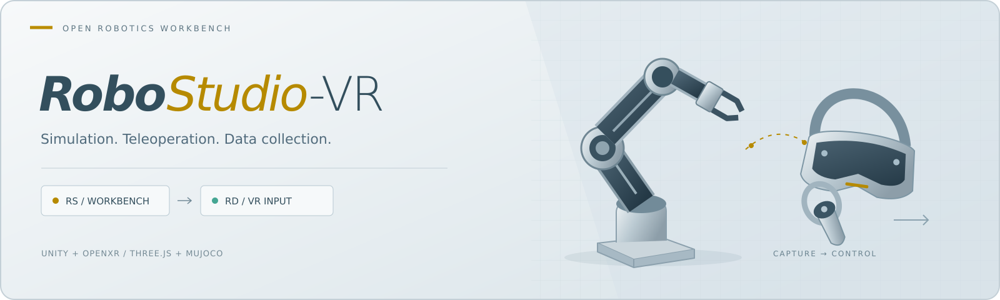
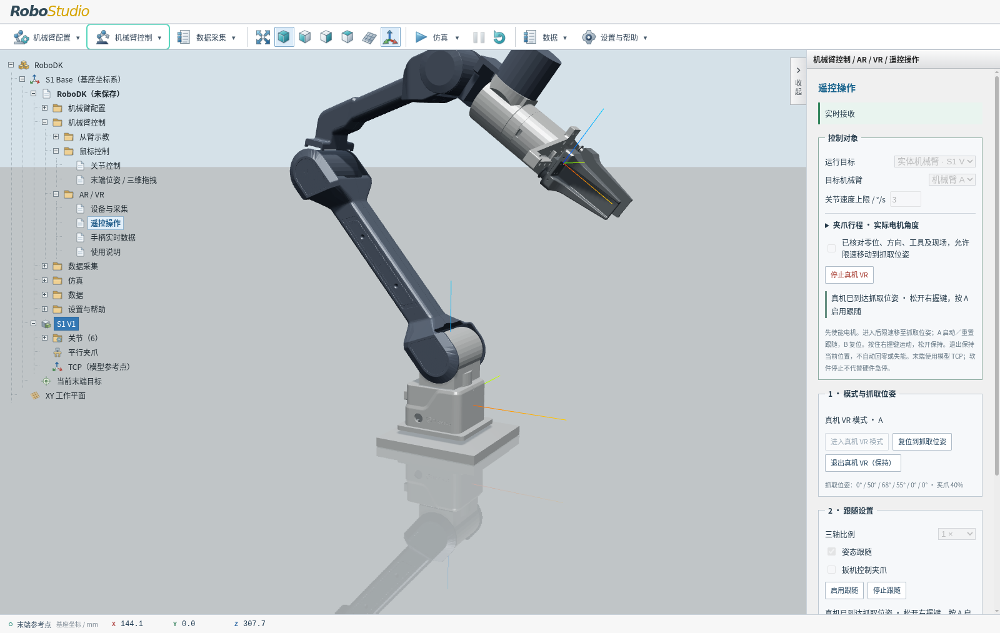
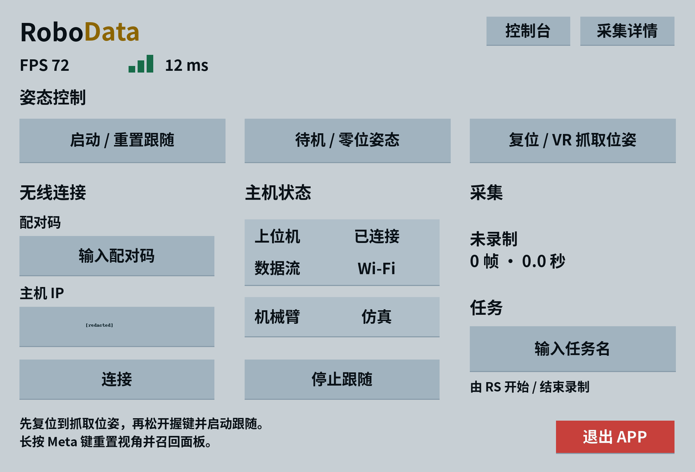
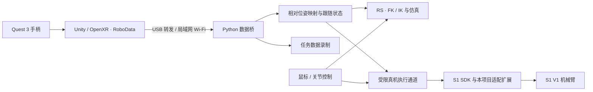

# RoboStudio-VR

**从自研 VR 采集端到机械臂仿真与控制工作台。**

RoboStudio-VR 面向 S1 V1 六轴机械臂，将电脑端 **RoboStudio（RS）** 与基于 **Unity / OpenXR 自主搭建的 RoboData（RD）** 连接起来，打通手柄输入、位姿映射、运动仿真、任务数据采集与受限真机控制。

RS 的网页版与 Electron 桌面版共用 Three.js 界面和 Python / MuJoCo 后端；RD 在 Meta Quest 3 上运行，通过 USB 转发或局域网 Wi-Fi 传输左右手柄数据。

[快速开始](docs/quickstart.md) · [SDK 与模型准备](docs/sdk-installation.md) · [RD / Unity](VR%20remote%20control/README.md) · [架构](docs/architecture.md) · [MIT 许可证](LICENSE)

## 全流程操作演示

https://github.com/user-attachments/assets/c259b69e-79b3-4d2c-a495-774408e26fc8

约 34 秒，包含头显内 RD 操作、机械臂遥操作与仿真画面对照。连接信息区域已遮挡，原始录像不随仓库公开。

[下载 MP4](https://raw.githubusercontent.com/A-WangJie/RoboStudio-VR/main/docs/videos/robostudio-vr-full-workflow.mp4)

## 界面预览



RS 工作台：机械臂场景、项目树、多级功能导航及 VR 控制面板。截图展示界面布局，不代表下载后已完成设备配置。



RD 控制面板布局预览：姿态控制、连接、主机状态及采集入口。网络地址已遮去，图中 FPS 与延时为预览数值，不是性能基准。

## 核心亮点：用 Unity 自主搭建 RD

RD 是这个项目自主开发的 Quest 应用，也是连接 VR 输入和 RS 平台的起点。工程包含 Unity 场景、C# 脚本、UI 资源及 Android 构建配置，使用 OpenXR 和 Input System 获取左右手柄的位置、旋转、按键、扳机、握键及追踪状态。

围绕实际遥操作流程，RD 提供头显内控制台、主机连接、跟随与复位快捷操作、连接状态反馈，以及任务和采集信息展示。电脑端通过 RS 的“RD数据桥配置”入口完成连接配置，并接收数据用于三维机械臂控制和任务录制。

手柄位姿经过相对起点标定与坐标映射，再交给逆运动学与执行通道。操作者可以重新建立跟随起点、返回 VR 抓取位姿，按住右握键控制运动、松开保持；右手 A 用于启动／重置跟随，B 用于复位到 VR 抓取位姿。此处跟随的是手柄所表达的末端运动，不测量或重建人体肘部姿态。

为适应开发和采集场景，项目支持 USB 与 Wi-Fi 两种链路，并提供自由摘戴采集配置。摘下头显后仍需保证摄像头能追踪手柄；无线调试和唤醒能力还取决于头显状态与系统权限。

## 从输入到执行



## 功能概览

| 模块 | 已有能力 |
| --- | --- |
| 工作台 | 三维机械臂、关节与夹爪控制、工程项目树、功能分类与快捷目录 |
| 鼠标控制 | 末端拖拽、长跟随、跟随速度比例、滚轮控制夹爪 |
| 仿真 | MuJoCo FK / IK、运动学与动力学、关节限位、路径碰撞检查 |
| VR 遥操作 | 相对位姿跟随、姿态跟随、抓取位姿、A / B 快捷键、追踪与失联处理 |
| 数据采集 | RD 手柄数据接收、任务命名、录制状态与采集管理 |
| 真机配置 | CAN 检测、状态读取、显式使能／失能、夹爪行程配置及鼠标／VR 执行入口 |
| 主从示教 | 单／双臂配对配置、只读主臂采集；不代表所有实体主从执行模式均已实现 |

## 安装与启动

当前验证平台为 **Ubuntu 22.04 / Linux x86_64**。RS 版本为 **0.3.0**，RD 为 **0.3.9**；Unity 工程使用 **6000.3.28f1**。跨平台安装包尚未完成发行。

### 1. 获取源码与 Python 依赖

```bash
git clone https://github.com/A-WangJie/RoboStudio-VR.git
cd RoboStudio-VR
python3 -m venv .venv
source .venv/bin/activate
python -m pip install -r requirements.txt
```

### 2. 准备 SDK 扩展与模型

**公开源码不附第三方 S1 模型；未导入模型前不能运行 S1 仿真。** 当前后端也需要本项目的 SDK 扩展，即使仅使用仿真，也请先完成这一步。

按 [SDK 与模型准备](docs/sdk-installation.md) 获取官方 SDK、安装三个自有扩展、导入模型并生成碰撞数据。SDK 的参考版本及全新编译尚待复验的限制均在该文档中列出；不要直接用上游最新版替换已有可用环境。

### 3. 选择运行方式

网页版（需要 Google Chrome）：

```bash
bash start-studio.sh
```

桌面版（首次下载固定版本的 Electron 运行环境）：

```bash
python tools/install_desktop_runtime.py
bash start-desktop.sh
```

两种入口复用同一套核心功能。不要双击 `app/index.html`；网页版关页后服务仍在终端运行，按 Ctrl+C 结束。桌面版退出时会回收自己的后端。

### 4. 接入 Quest 3

1. 按 [RD 说明](VR%20remote%20control/README.md) 在 Unity Hub 打开 `VR remote control/QuestControllerClient`，配置 Android / OpenXR 并构建应用。
2. 将 Quest 3 通过 USB 连接电脑，开启开发者模式并允许 USB 调试。
3. 在 RS 中进入“机械臂控制 → AR / VR → 设备与采集”，使用“RD数据桥配置”，在 RD 中确认连接。
4. 先检查手柄追踪、按键和数据流，再选择仿真目标进入 VR 模式，建立跟随起点。
5. 先在仿真中验证方向、姿态、复位和夹爪，再按 [真机控制说明](docs/mouse-hardware-control.md) 完成设备与标定核对。

Wi-Fi 模式需电脑与头显网络可互通；更换网络后检查主机 IP。具体端口、配对与环境变量见 [RD 配置](VR%20remote%20control/docs/configuration.md)。

## 工程结构

```text
app/                         Three.js 界面、模型加载与交互
backend/                     MuJoCo 仿真、真机适配与运行路径
desktop/                     Electron 桌面外壳
VR remote control/
  QuestControllerClient/     Unity 场景、脚本、资源和项目设置
  bridge/                    数据桥、协议、映射和采集
  ui/                        RS 内嵌的 RD 面板
integrations/s1_sdk_extensions/  本项目自有 SDK 扩展
tools/                       SDK 扩展安装、模型导入等工具
config/                      可公开配置示例
tests/                       自动检查
docs/                        架构、配置与使用文档
```

模型由用户导入 `app/assets/s1_v1/`。运行时生成的配置、日志、录像、安装包、Unity 缓存及 Electron 运行环境不提交到源码仓库。

## 验证与使用边界

完成依赖与模型准备后，可运行：

```bash
bash scripts/test.sh
# 可选：已安装对应浏览器、桌面环境与 Node.js 后
S1_STUDIO_CHROME_TESTS=1 bash scripts/test.sh
S1_STUDIO_DESKTOP_TESTS=1 bash scripts/test.sh
```

已有自动检查主要使用模拟手柄输入与模拟电机；发布前在隔离副本中恢复模型并验证了协议、仿真、SDK 扩展及集成检查。官方 SDK 的全新原生构建、跨平台运行和现场真机测试需要另行完成，见 [发布状态](docs/open-source.md)。

当前 TCP 是未实物标定的模型参考点；碰撞检查采用网格与离散采样。真机使用需核对零位、方向、工具和夹爪标定，软件停止不能代替硬件急停。

## 开源与致谢

自有 RS / RD 代码采用 [MIT](LICENSE)，版权署名 **A-WangJie**。第三方代码、字体、SDK、模型及衍生数据遵循各自许可，根目录 MIT 不替代第三方授权。

机械臂底层 SDK 来源于 **[YHRG-Robotics / S1_SDK_V2](https://github.com/YHRG-Robotics/S1_SDK_V2)**。本项目提供的 `safe_can`、`device_session`、`native_session` 是自有兼容扩展，不是上游官方 API；模型授权与安装范围见 [第三方清单](THIRD_PARTY_NOTICES.md)。同时感谢 Three.js、MuJoCo、Electron、Unity / OpenXR、websockets 和 Noto CJK 等项目及工具。

问题反馈请提交 [Issue](https://github.com/A-WangJie/RoboStudio-VR/issues)，说明版本、运行方式、复现步骤和经过脱敏的日志。

[项目概览](docs/project-overview.md) · [机械臂配置](docs/arm-configuration.md) · [参数与路径](docs/configuration.md) · [贡献说明](CONTRIBUTING.md)
