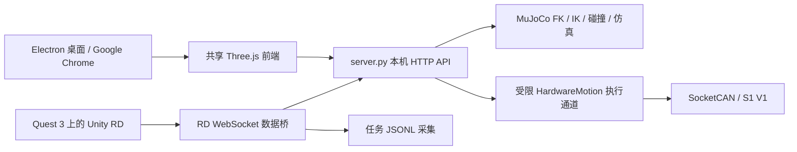

# DK / RoboStudio 架构

DK 是共享前端、仿真后端和真机适配的平台；RS 是桌面工作台；RD 是 Unity / Quest 输入与采集模块。它们共用输入权限和机械臂状态，并通过本机接口衔接。

## 模块边界

| 位置 | 职责 |
| --- | --- |
| app/ | Three.js 模型、工具栏、项目树、参数页、鼠标目标及错误展示 |
| backend/simulation.py | 模型 FK、限位 IK、离散路径碰撞、运动学与动力学线程 |
| backend/hardware*.py、s1_can.py | 显式探测、状态、使能／失能、共享执行权限、限速与反馈 |
| backend/paths.py | 本机配置、锁、审计、日志位置，供 Python 模块统一使用 |
| server.py | 仅监听本机；静态内容限于 app，提供仿真、真机及 RD 白名单代理 |
| desktop/ | Electron 窗口、受限 preload、原生菜单、文件对话框及专属后端管理 |
| scripts/ | 启动、解释器选择、检查和源码导出；根启动文件保留兼容入口 |
| VR remote control/ | 独立 RD 源码、Unity 工程、采集和跟随映射 |

桌面渲染进程不开放 Node.js；文件操作经受限 IPC，机械臂目标经本机 HTTP API。桌面启动会拉起专属 Python 后端并等待就绪，关闭窗口时暂停并回收该进程。网页调试关闭标签页不会退出服务。

## 运行行为

启动六轴全零且不自动进入 VR。进入 VR 后移动到抓取位姿；位置映射、姿态、右手 A／B 和按住握键规则见 [RD 自然跟随](../VR%20remote%20control/docs/usb-telemetry.md)。工程整理只调整存储与启动路径，未改变这些规则。

仿真后端负责状态序列、逆解、限位与碰撞判定。鼠标和 VR 真机执行复用 HardwareMotion，要求显式接管并满足新鲜反馈、限速与输入权限；启动软件不自动使能电机。SDK 原生对照测试仅构造离线值对象，不连接 CAN。

## 模型与显示

S1 V1 的配套 XML、九个 STL 与模型清单位于 `app/assets/s1_v1/`，模型资源本身不依赖相邻 SDK；当前真机适配模块另需安装旧 SDK 的本地安全扩展。重新导入模型使用 `tools/import_s1_model.py --resource ...`。模型哈希和碰撞分解来源保留。Three.js 坐标为 Z 向上，使用米、弧度和右手系，界面显示 mm / deg。

TCP 是模型参考点，尚不能视为经过实物标定的 TCP；真机夹爪使用用户标定的电机行程。碰撞使用凸包／分解网格和离散路径采样，不是连续时间的硬件防撞保证。模型再分发条件见 [第三方清单](../THIRD_PARTY_NOTICES.md)。

只有明确的 WebGL2 上下文不可用才降级到 Canvas。模块、资源、代码和渲染错误分别显示，保留原始原因。网页和桌面共用这些错误处理路径。

## 本机状态与发布

`.local/` 保留设备配置、Electron profile、工作区和备份，`artifacts/` 保存日志、截图及报告；这两类都不提交。RD 继续使用独立配置，DK 共享采集仍在 `recordings/`。源码导出同时包含 DK 与经过筛选的 RD，排除运行时、APK、缓存和私有设备状态。

Git 分支属于整个仓库。后续创建 rd 分支不会自动把一个目录变成独立仓库；本次没有创建 Git 仓库、分支或远程连接。

2026-11-19 适配更新：RS 真机检测、状态与运动通信已归入本地旧 SDK 的 `safe_can` 扩展；原生高层控制仍保留。初始化行为、占用和终端切换规则见 [共用旧 SDK](shared-old-sdk.md)。
